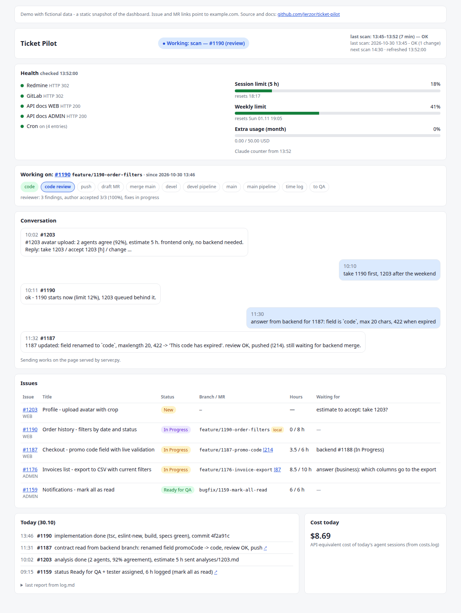

# Ticket Pilot

An autonomous AI agent that takes issues from an issue tracker and drives them through the whole frontend workflow: **analysis → estimate → implementation → code review → merge request → release → time log → hand-over to QA**, with a human approving only the key decisions.

Built on [Claude Code](https://docs.anthropic.com/en/docs/claude-code) running headless from cron, with a multi-agent setup, a cost guard and a small web dashboard for talking to the agent from a phone.

**[▶ Live demo of the dashboard](https://jerzor.github.io/ticket-pilot/)** (static snapshot, fictional data)



> The screenshot shows the demo mode with fictional data. The agent was built for and used in a real project (Redmine + GitLab, two Angular apps); everything company-specific has been removed from this repository.

## Why

A lot of a developer's day is process, not code: reading tickets, chasing backend contracts, estimating, opening MRs, clicking through pipelines, logging hours, moving statuses. Ticket Pilot does that loop on its own and leaves the developer two jobs: **accept the scope** ("take 1187") and **answer the questions** only a human can answer.

## How it works

```mermaid
flowchart LR
    cron([cron, every 45 min]) --> guard{limit and VPN<br/>pre-checks}
    guard -- fail --> skip[skip run,<br/>zero tokens]
    guard -- ok --> scan[Scan tracker<br/>diff vs state.json]
    scan --> new{new issue?}
    new -- yes --> A[Agent A] & B[Agent B]
    A & B --> agree{≥ 75%<br/>agreement?}
    agree -- no --> arb[Arbiter agent]
    agree -- yes --> est[Estimate + plan<br/>to the web chat]
    arb --> est
    est --> human{{"user: take 1187"}}
    human --> impl[Implementer agent<br/>in a git worktree]
    impl --> checks[tsc · new ESLint errors · build · specs]
    checks --> cr[Independent reviewer<br/>requirements matrix]
    cr --> disp{dispute?}
    disp -- yes --> arb2[Arbiter] --> mr
    disp -- no --> mr[Push + draft MR]
    mr --> be{backend<br/>merged?}
    be -- not yet --> wait[wait, re-check<br/>backend mirror each scan]
    be -- yes --> rel[Merge → devel → main<br/>watch pipelines]
    rel --> time[Time log] --> qa[Status → QA,<br/>assign tester]
```



Every run is a **fresh, non-interactive Claude Code session** (`claude -p --chrome`) started by `bin/run-scan.sh`. The session follows the instructions in [`skill/`](skill/SKILL.md): it reads the tracker in the browser, compares it with `state.json`, and picks the most important piece of work: resume interrupted work first, then user commands, releases, QA returns, implementation, and finally new analyses.

## Design decisions

| Problem | Solution |
| --- | --- |
| **One model's analysis can be wrong with full confidence** | Two agents analyse every issue independently and must agree on ≥ 75% of scope, plan and estimate; otherwise a third agent arbitrates. Only then does the user see an estimate. |
| **Nobody reads the agent's diff** | A fresh reviewer that never saw the author's reasoning builds a **requirements matrix** (each requirement → `done / partial / missing` with `file:line` evidence) before hunting bugs. Author/reviewer agreement thresholds decide between "fix and re-review once", "arbiter" and "ask the human". |
| **The tracker's REST API is disabled** | The agent works through the real browser (Claude in Chrome), like a person would: reads pages as text, fills forms, verifies success messages. |
| **Waiting for the backend is the real bottleneck** | Backend repos are kept as bare blobless mirrors. Every scan checks if the backend branch exists or is merged and **reads the contract from the backend code** (DTOs, validators, error messages) instead of asking people. |
| **An unattended agent must never cost real money** | `guard/limit-check.py` reads the plan usage counter (no tokens spent): no start above 93%, a watchdog kills the session at 97% or the moment paid extra usage grows. **Fail-closed:** if the counter cannot be read, the run is skipped. |
| **Runs get killed mid-work** (limits, timeouts) | Every multi-step job writes `inProgress.step` after each step; the next run verifies the real state (git, MRs, tracker) and resumes from the first unfinished step without repeating any side effects. |
| **Agents make up timestamps** | Shell scripts own the clock: run start/end and `checkedAt` are written by `run-scan.sh`, not by the model. |
| **Background subagents can't ask for permission** | A strict tool allowlist plus a few purpose-built scripts (`state-jq.sh` for atomic state updates, `eslint-new.sh` for "only new lint errors") so agents never need a command that would be denied. |
| **Cost** | The coordinating session runs on a cheaper model; only analysis, coding, review and arbitration go to the strongest model. An empty scan costs about $0.30. |
| **Talking to the agent away from the desk** | A token-protected web page (localhost by default, LAN with `web.host: 0.0.0.0`): live status, issues, today's actions, limits, and a chat. Messages are picked up every minute, 24/7, with zero tokens spent while there are none. |
| **Human stays in control** | The agent never starts work without "take &lt;nr&gt;", never sends messages to colleagues (it drafts them), never comments in the tracker, never force-pushes and never merges while business/backend questions are open. |

## Tech stack

- **Claude Code** (headless `claude -p`), skills, subagents, Claude in Chrome
- **Bash**: orchestration, cron jobs, guards (`bin/`)
- **Python 3**, standard library only: dashboard, web server, chat, usage guard (`web/`, `guard/`, `lib/`)
- **cron** + **systemd --user**
- **git worktrees**, GitLab push options, `jq`

About 1,000 lines of scripts and ~27 KB of agent instructions.

## Repository layout

```
bin/
  run-scan.sh          one agent run: VPN + limit pre-checks, watchdog, Claude session, logging
  web-poll.sh          every minute: new chat messages -> a run (zero tokens otherwise)
  evening-time-log.sh  evening retry of the time log, only if the afternoon run did not do it
  tracker-check.sh     is the tracker reachable (VPN)?
  state-jq.sh          atomic state.json update with a jq filter
  eslint-new.sh        only ESLint errors introduced by the branch
  install-skill.sh     renders skill/ into ~/.claude/skills with your paths
  build-pages.sh       rebuilds the GitHub Pages demo (docs/) from demo/data
guard/limit-check.py   start / watch / status checks against the plan usage limits
web/
  dashboard.py         static dashboard from the state files (cron, every minute)
  server.py            token-protected dashboard + chat over the LAN
  chat.py              chat storage and CLI used by the agent
lib/                   shared config + usage counter
skill/                 the agent's instructions (core + per-area reference files)
deploy/                crontab and systemd examples
demo/                  fictional data for the demo dashboard
docs/                  GitHub Pages: the static demo (index.html) and the screenshot
```

## Can I run it?

**The demo runs anywhere. The full agent is a personal tool** built around one team's workflow (Redmine + GitLab + Angular apps, Linux, Claude Code) and needs access to those systems. It is published as a **reference implementation**: the interesting parts are the multi-agent analysis and review, the cost guard, resuming interrupted work and the human-in-the-loop rules, not a plug-and-play product.

| I want to… | How |
| --- | --- |
| see what it looks like | open the [live demo](https://jerzor.github.io/ticket-pilot/) - nothing to install |
| click around, try the chat | run the local demo below (Python 3 only, macOS / Linux) |
| understand how the agent thinks | read [`skill/SKILL.md`](skill/SKILL.md) and [`skill/refs/`](skill/refs) - the agent's full instructions |
| see the orchestration | [`bin/run-scan.sh`](bin/run-scan.sh) and [`guard/limit-check.py`](guard/limit-check.py) |
| run it on my own projects | Linux + the setup in [Running it for real](#running-it-for-real); expect to adapt `skill/` to your tracker and release process |

## Try the demo locally

No tracker, GitLab or Claude account needed - only Python 3 (standard library):

```bash
# static dashboard
python3 web/dashboard.py --demo && open demo/dashboard.html   # Linux: xdg-open; the same page is in docs/index.html

# dashboard + working chat (runs on a temporary copy of the demo data)
python3 web/server.py --demo --port 8799                      # open the printed URL
```

In the demo the chat stores your messages, but nothing answers them - replies come from the agent session, which needs the real setup below.

## Running it for real

Requirements: Linux (`flock`, `notify-send`, cron, systemd), Claude Code with Claude in Chrome, Python 3.10+, `jq`, `curl`, Node.js for the frontend checks.

```bash
cp config.example.json config.json      # tracker URL, projects -> repos, release flow, testers, limits
bin/install-skill.sh                    # installs the skill as /ticket-pilot, creates the data directory

# backend mirrors (one per project, name = projects.<KEY>.backendMirror) - bare and blobless, fetched by the agent
git clone --bare --filter=blob:none <backend repo URL> ~/.ticket-pilot/be-web.git

crontab -e                              # paste deploy/crontab.example with /path/to/ticket-pilot replaced

# web dashboard: first replace the path in ExecStart, then
cp deploy/ticket-pilot-web.service ~/.config/systemd/user/ && systemctl --user enable --now ticket-pilot-web
```

Pause everything with `touch ~/.ticket-pilot/.paused` (remove the file to resume). The access token for the web page is in `~/.ticket-pilot/.web-token`.

The skill is written for a Redmine + GitLab + Angular setup with two release flows (`direct`: devel and main at once; `two-stage`: QA on devel, main and a manual deploy after acceptance). Adapting it to another tracker is mostly a matter of editing `skill/`.

## Limitations

- The usage guard relies on an undocumented endpoint that Claude Code itself uses; it may change.
- Browser automation is slower and more fragile than an API.
- This is a personal productivity tool for one developer, not a multi-user service.

## License

MIT
